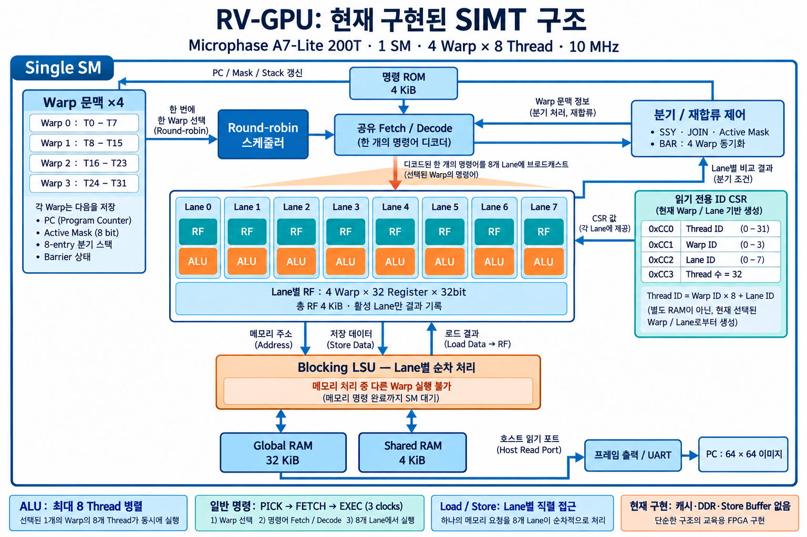

# A7-Lite 200T: 1 SM / 4 Warp / 8 Thread SIMT GPU

Microphase A7-Lite **XC7A200T-FBG484-2**용 소형 RISC-V SIMT GPU입니다.
**공유 fetch/decode 하나와 8개의 ALU lane을 4개의 warp가 번갈아 사용**합니다.
warp별 PC·active mask·분기 스택, thread별 레지스터, shared memory, block barrier를 구현했습니다.



이전 독립 RV32I 코어 4개의 manycore 설계와 다릅니다. 이전 예제는 `legacy/manycore/`에
보관했고, `rtl/rv32i_core.v`는 이전 명령어 테스트의 기준 코어로만 남겨 두었습니다.
새 FPGA top은 `simt_sm`을 사용하며 scalar core를 인스턴스화하지 않습니다.

| 항목 | 구현 |
|---|---|
| 실행 문맥 | SM 1개, warp 4개, thread/warp 8개: 총 32 thread |
| 연산부 | 정수 ALU 8개, 공유 decoder 1개 |
| 스케줄링 | 명령 단위 round-robin, barrier 대기 warp 제외 |
| 분기 | 8-bit active mask, warp당 8-entry SIMT stack, 중첩 분기·합류 |
| 동기화 | 32-thread block barrier, 서로 다른 barrier 위치·deadlock 오류 검출 |
| 레지스터 / 메모리 | RF 4 KiB, instruction ROM 4 KiB, global 32 KiB, shared 4 KiB |
| 보드 동작 | 10 MHz SM, 64×64 RGB 이미지 생성, USB UART 출력 |

자세한 구조, 상태 전이, ISA 확장, 메모리 맵, 제한 사항은 [설계 문서](docs/architecture.md)를 참고하세요.

## 빌드와 실행

필요 도구는 RV32I/ILP32 GNU RISC-V 툴체인, Python 3, Icarus Verilog,
200T를 지원하는 Vivado입니다. 현재 환경의 Vivado 2022.1 경로를 Makefile 기본값으로 사용합니다.

```bash
make test
make bit
make program
python3 scripts/frame.py --port /dev/ttyUSB0 --output build/captured.ppm --verify
```

- `make test`: assembly 커널 빌드, ISA·SIMT 제어·이미지·UART 검증.
- `make bit`: 200T 합성·배치배선·타이밍 검사 후 `build/a7_simt_gpu.bit` 생성.
- `make program`: 연결된 200T 한 대에 **새 SIMT 비트스트림**을 JTAG SRAM으로 다운로드.
  SPI flash에는 기록하지 않습니다. 명시적으로 이 명령을 실행해야 다운로드됩니다.
- 캡처에는 `pyserial`이 필요하며 보드의 USB UART 포트 이름을 맞춰야 합니다.

다른 툴 경로는 `make bit VIVADO=/path/to/vivado`,
`make test CROSS=riscv32-unknown-elf-`처럼 지정합니다.
시뮬레이션은 PATH의 Icarus 또는 현재 환경의 `/tmp/gpu-iverilog`를 사용합니다.
비트스트림의 커널을 바꾸려면 재빌드해야 하며 UART 커널 업로드는 지원하지 않습니다.
이전 manycore 비트스트림 `build/a7_gpu.bit`과 새 파일을 혼동하지 마세요.

## 파일

| 파일 | 역할 |
|---|---|
| `rtl/simt_sm.sv` | warp scheduler, PC/mask/stack, barrier, LSU, global/shared RAM |
| `rtl/simt_decode.sv` | SM 공통 명령 decoder |
| `rtl/simt_alu.sv` | lane별 정수 ALU |
| `rtl/simt_regfile.sv` | lane별 4-warp 레지스터 bank |
| `rtl/compute_gpu.sv` | 외부 start/status/host read 인터페이스 |
| `rtl/gpu_demo.sv`, `rtl/a7_gpu_top.sv` | 자동 launch, 픽셀 전송, A7-Lite 클럭/reset |
| `firmware/render_simt.S` | 32-thread 병렬 픽셀 커널, divergence와 shared-memory 교환 |
| `firmware/selftest_simt.S` | 중첩 분기·공유 메모리·메모리 폭·branch 비교 테스트 |
| `firmware/simt.inc` | SSY/JOIN/BAR assembler macro |
| `docs/architecture.md` | 설계 명세와 프로그래밍 규칙 |

초기 레지스터는 a0=tid(0..31), a1=32, a2=framebuffer base(0),
sp=`0x8000 - tid*256`입니다. 픽셀 p는 thread `p % 32`가 계산하여 global 주소 `p*4`에 저장합니다.
각 thread는 128개 픽셀을 담당합니다. 코어별 결과를 다시 섞는 기존 방식은 제거했습니다.

## 프로그래밍 제한

현재 실행부는 **비파이프라인 single-issue**이며, LSU는 lane별 접근을 순차 완료합니다.
비차단 memory, scoreboard, coalescing, cache, DDR, FP32, texture, rasterizer,
HDMI 및 CUDA/OpenGL/Vulkan 호환 계층은 없습니다.

분기가 갈라지는 위치에는 `SSY label`, 합류 위치에는 `JOIN`을 명시해야 합니다.
일반 GCC는 이 명령을 자동 생성하지 않으므로 현재 커널은 assembly로 제공합니다.
기존 C 커널을 그대로 실행하는 기능은 새 SIMT 설계의 지원 범위가 아닙니다.
warp 내 반복 횟수가 다른 loop, divergent indirect jump, thread별 조기 종료도 제한됩니다.

## UART와 보드

새 UART 프레임은 `GPU2`입니다. 기존 `GPU1` 캡처 프로그램과 구분됩니다.

| 바이트 | 내용 |
|---|---|
| 0..3 | ASCII GPU2 |
| 4..6 | width=64, height=64, threads=32 |
| 7 | warp 오류 bitmap, 하위 4비트 |
| 8..16391 | 4096개의 little-endian 0x00RRGGBB 픽셀 |

UART는 115200 baud, 8-N-1입니다. 10 MHz/87 분주로 실제 전송률은 약 114943 baud입니다.
완성된 이미지를 약 1.43초 동안 전송하고 약 1초 간격으로 반복합니다.
`led[0]`은 정상 완료, `led[1]`은 오류 논리 신호입니다. CRC는 없습니다.

제조사 [A7-Lite 자료](https://fpga-docs.microphase.cn/projects/documentation-of-microphase-fpga-board/en/latest/DEV_BOARD/A7-LITE/A7-Lite_Reference_Manual.html)와
기존 프로젝트에서 확인한 핀은 clock J19, UART TX V2, LED M18/N18입니다.
제약 파일은 `constraints/a7_lite_200t.xdc`입니다.

## 검증

- 기존 scalar 기준 코어: 2,582개 directed/random 명령어 벡터.
- **새 SIMT decoder/ALU**: 1,922개 산술·주소 생성 벡터 및 illegal encoding 검사.
- SIMT 통합: round-robin, 중첩 분기·mask 복원, 모든 branch 비교 종류,
  inactive lane의 잘못된 주소 억제, shared-memory cross-warp 교환,
  warp별 도착 시간을 다르게 한 barrier 대기와 반복 barrier.
- load/store: byte·halfword·word, sign/zero extension, x0, 동일 주소 store 순서,
  vector 전체 주소 검증 후 commit, reset 중단.
- 오류: SSY 누락·stack overflow·JOIN underflow, divergent JALR,
  partial exit/barrier, 주소·정렬 오류, barrier deadlock·서로 다른 barrier 위치, 재실행.
- 이미지: 32 thread가 생성한 4,096개 픽셀을 독립 Python 기준과 비교.
- UART: pin-level start/data/stop과 전체 16,392바이트 및 반복 프레임 헤더 비교.

기본 데모의 시뮬레이션 결과는 **56,352클럭 = 10 MHz에서 5.6352 ms**입니다.
warp 명령 17,158개, divergent split 55회, block barrier release 1회를 관측했습니다.
launch 레지스터 초기화와 완료 검출을 포함하고 UART 전송 시간은 제외한 수치입니다.
이전 manycore와 명령 수·실행 방식이 달라 단순 성능 향상을 의미하지 않습니다.

시뮬레이션 이미지는 `build/render.ppm`, 테스트 로그는 `build/simt-test.log`,
배치배선 결과는 `build/simt_timing.rpt`, `build/simt_utilization.rpt`, `build/simt_drc.rpt`입니다.
실물 보드 다운로드와 UART 수신 검증도 완료했습니다. 아래 실측 결과를 참고하세요.

### 200T 최종 구현 결과

Vivado 2022.1, `xc7a200tfbg484-2`, 2026-10-23 최종 배치배선/비트스트림 결과입니다.

| 항목 | 결과 |
|---|---|
| LUT | 8,974 (6.71%) |
| Flip-flop | 942 (0.35%) |
| RAMB36 | 9 (global 8 + shared 1) |
| 10 MHz setup WNS / hold WHS | +62.202 ns / +0.100 ns |
| 타이밍 실패 endpoint | 0 |
| 최종 DRC 위반 | 0 |
| 비트스트림 | `build/a7_simt_gpu.bit` |
| 소스/비트스트림 SHA-256 | `build/simt-manifest.sha256` |
| 실물 보드 다운로드 / UART 캡처 | 완료, 반복 프레임 3개 검증 PASS |

BRAM control의 비동기 reset 경고를 방지하기 위해 SM reset을 최종 동기화하고
`NoBramPowerOpt`를 적용했습니다. DRC waiver는 사용하지 않았습니다.
추가 제어 흐름 테스트 결과는 `build/simt-control-test.log`에 기록했습니다.

### 실제 보드 동작 검증 (2026-10-23)

- JTAG 장치 `210241661020`의 XC7A200T에 `a7_simt_gpu.bit` SRAM 다운로드 완료.
- Vivado startup status: HIGH. SPI flash는 변경하지 않았습니다.
- CH340 UART `/dev/ttyUSB1`, 115200 baud로 `GPU2` 프레임 수신.
- 반복 전송된 프레임 3개에서 각각 4,096개 픽셀을 기준과 비교: 불일치 0, warp 오류 bitmap 0.
- 결과: `build/board-test/results.json`, 픽셀 payload: `build/board-test/frame-*.bin`.
- 실제 수신 이미지: `build/board-captured.ppm`, 미리보기: `build/board-captured.png`.

이 검증은 부팅 시 한 번 실행된 커널 결과의 반복 UART 전송을 확인한 것입니다.
3회의 독립 커널 재실행이나 전원 재인가 시험은 아니며, 연산 시간은 실측하지 않았습니다.
현재 FPGA는 이 SIMT 데모를 실행 중입니다. SRAM 구성이므로 전원을 끄면 유지되지 않습니다.

## 상세 해설 PDF와 보존된 검증 자료

- [SIMT GPU 설계 상세 해설 PDF — 30쪽](docs/simt_architecture_explained_ko.pdf)
- [PDF LaTeX 원본](docs/simt_architecture_explained_ko.tex): `bash scripts/build_architecture_pdf.sh`로 재생성합니다. XeLaTeX, 한국어 TeX 패키지와 NanumGothic/DejaVu 글꼴이 필요합니다.
- [최종 자원 사용량](docs/validation/simt_utilization.rpt)
- [최종 타이밍](docs/validation/simt_timing.rpt)
- [최종 DRC](docs/validation/simt_drc.rpt)
- [실물 보드 UART 검증 결과](docs/validation/board-test-results.json)

`docs/validation/`은 검증 당시 리포트의 보존본입니다. 새 빌드 결과는 `build/`에 생성됩니다.
비트스트림과 빌드 중간 파일은 Git에 포함하지 않으며 `make bit`로 생성합니다.

### 읽기 전용 ID CSR

`firmware/simt.inc`의 `READ_CSR rd, CSR_THREAD_ID/CSR_WARP_ID/CSR_LANE_ID/CSR_NUM_THREADS`로
ID를 조회할 수 있습니다. 주소는 0xCC0~0xCC3이며 `CSRRS rd, csr, x0` 읽기만 지원합니다.
기존 a0/a1 초기화는 유지합니다. 전체 Zicsr 지원은 아닙니다.
`make test`에 모든 warp/lane, 활성 mask, 잘못된 CSR 접근 검증을 포함했습니다.
자세한 동작은 [설계 문서](docs/architecture.md#읽기-전용-id-csr)를 참고하세요.

기존 PDF와 보드 자원·타이밍·실물 검증 리포트는 ID CSR 추가 전 설계의 기록입니다.
이번 CSR 변경의 보드 결과로 해석하지 마세요.
