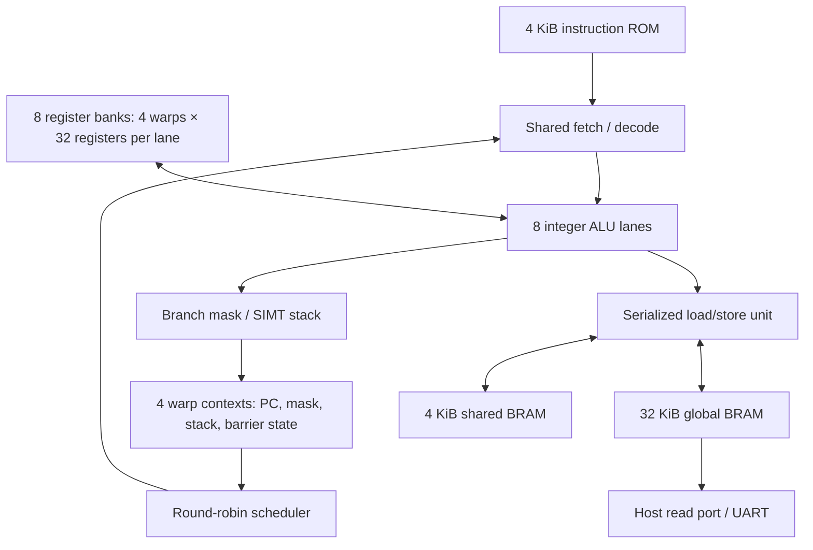

# SIMT SM 설계: 4 Warp × 8 Thread

## 실행 자원과 문맥

이 설계는 **8개의 정수 ALU를 4개 warp가 공유하는 단일 SM**이다.
32개의 스칼라 CPU를 배치하지 않는다. thread마다 독립적인 명령 fetch/decode나 PC는 없다.
한 번 실행할 때 32-thread block 하나를 배치하며, 실행 중 새 block을 배치하는 기능은 없다.



| 자원 | 사양 |
|---|---|
| SM 수 | 1 |
| resident warp 수 | 4 |
| thread/warp | 8 |
| resident thread 합계 | 32 |
| 물리 정수 ALU | 8 |
| thread당 레지스터 | RV32I x0..x31, 각 32비트 |
| 레지스터 파일 총 용량 | 4 KiB; lane별 128×32비트 LUT RAM |
| warp당 PC / active mask | 32비트 / 8비트 |
| warp당 SIMT 스택 | 8 entries |
| 명령 ROM | 4 KiB, 공통 프로그램 |
| global / shared RAM | 32 KiB / 4 KiB, 동기 읽기 BRAM |
| 기본 SM 클럭 | 10 MHz, 보드 50 MHz에서 MMCM 생성 |

`tid = warp_id * 8 + lane_id`이다. 각 물리 lane의 레지스터 파일 주소는
`{warp_id, register_id}`이고, x0 읽기는 항상 0이다. warp를 바꿀 때 register copy는 없다.
`INIT` 상태에서 128클럭 동안 8개 레지스터 bank를 동시에 초기화한다.
RAM 내용은 launch/reset으로 지우지 않으며 FPGA 구성 시에만 0으로 초기화된다.
보드 최상위는 MMCM lock을 동기화한 뒤 추가 synchronous reset 레지스터를 거쳐
SM을 제어한다. BRAM enable/write strobe에 비동기 reset이 직접 전파되지 않게 한다.
Vivado 2022.1의 기본 BRAM power optimization이 host read enable에 비동기 reset
fan-in을 다시 만들기 때문에, 빌드는 `opt_design -directive NoBramPowerOpt`를 사용한다.
이는 [AMD의 opt_design 옵션](https://docs.amd.com/r/2021.1-English/ug835-vivado-tcl-commands/opt_design)이며
DRC 경고를 숨기는 waiver는 적용하지 않는다.

## 읽기 전용 ID CSR

일반 레지스터 x0..x31과 별도로 다음 네 개의 프로젝트 전용 CSR을 제공한다.
ID는 별도 RAM에 저장하지 않고 실행 중인 warp 번호와 물리 lane 번호에서 생성한다.
현재는 SM 하나에서 block 하나만 실행하므로 thread ID는 block 내부 번호이다.

| 주소 | 이름 | 활성 lane에 반환하는 값 |
|---|---|---|
| 0xCC0 | CSR_THREAD_ID | warp_id * 8 + lane_id (0..31) |
| 0xCC1 | CSR_WARP_ID | warp_id (0..3), warp 내 동일 |
| 0xCC2 | CSR_LANE_ID | lane_id (0..7) |
| 0xCC3 | CSR_NUM_THREADS | 32 |

지원 인코딩은 `CSRRS rd, csr, x0` (`csrr rd, csr` 의사 명령)뿐이다.
SYSTEM opcode=0x73, funct3=2, rs1=0, csr=위 네 주소로 한정한다.
`rd=x0` 읽기도 유효하지만 결과를 버린다. 비활성 lane의 레지스터는 보존한다.
일반 ALU와 같은 PICK/FETCH/EXEC 3클럭으로 실행하며 내부 kind는 12이다.

CSR 쓰기, 다른 CSR 명령 형태(CSRRC/CSRRSI 등), 미지원 주소는 fault code 2로
warp를 정지시킨다. 목적 레지스터를 쓰지 않고 fault PC를 유지한다.
CSRRS의 rs1 필드가 x0가 아니면 그 레지스터의 실제 값이 0이어도 거부한다.
전체 Zicsr 확장이나 privileged trap CSR을 구현한 것은 아니다.

기존 launch ABI (`a0=tid`, `a1=32`)는 유지한다. ID를 일반 레지스터에서 덮어써도
CSR에서 다시 읽을 수 있다. `firmware/simt.inc`는 RV32I 빌드에서도 사용할 수 있는
`READ_CSR` 매크로를 제공한다. 일반 ALU의 피연산자로 쓰려면 GPR로 읽어야 한다.

```asm
.include "firmware/simt.inc"
READ_CSR a0, CSR_THREAD_ID
READ_CSR t0, CSR_WARP_ID
READ_CSR t1, CSR_LANE_ID
READ_CSR a1, CSR_NUM_THREADS
```

`sim/tb_simt_csr.sv`는 SYSTEM 인코딩의 모든 CSR 주소/funct3/rs1 조합,
32개 thread의 반환값, 홀수/짝수 활성 mask, x0, 잘못된 접근의 부작용 억제와
재시작을 검증한다. selftest 커널도 a0/a1을 덮어쓴 뒤 CSR에서 복원한다.

## 발행과 스케줄링

제어 상태는 `IDLE → INIT → PICK → FETCH → EXEC`이다.
`PICK`이 round-robin 순서로 runnable warp를 선택하고, `FETCH`가 한 명령을 읽는다.
`EXEC`에서 공유 디코더가 생성한 제어 신호를 8개 lane에 배포한다.
active mask가 1인 thread만 레지스터 쓰기와 메모리 접근에 참여한다.

일반 ALU 명령은 warp당 3클럭이다. 이것은 **single-issue, 비파이프라인** 구현이다.
4개 warp가 동시에 명령을 발행하지 않는다. 정상 명령 실행 후 다음 warp로 이동한다.
이전 명령이 완료된 뒤 다음 명령을 실행하므로 register scoreboard가 필요하지 않다.

LSU는 한 memory instruction을 완료할 때까지 SM을 점유한다.
따라서 다른 warp의 연산으로 memory latency를 숨기는 기능은 아직 없다.
이 구분은 중요하다: warp 문맥과 스케줄러는 구현했지만, 현대 GPU의 비차단 실행 구조를
모두 구현한 것은 아니다.

## 분기와 재합류

RV32I conditional branch는 8개 비교 결과를 active mask와 결합한다.
모두 참/거짓이면 warp PC만 갱신한다. 결과가 섞이면 taken path를 먼저 실행하고,
fall-through path의 PC와 mask를 warp별 스택에 보관한다.

컴파일러가 재합류 지점을 알려줘야 하므로 custom-0 opcode에 세 명령을 정의했다.
이는 이 프로젝트 전용 확장이며 표준 RISC-V 또는 NVIDIA ISA의 바이너리 인코딩이 아니다.

| 명령 | 인코딩 | 동작 |
|---|---|---|
| `SSY label` | opcode=0x0b, funct3=0, rs1=rd=0, signed I-immediate | `PC+imm`을 join PC로 저장하고 현재 mask를 push |
| `JOIN` | 0x0000100b | 대기 경로가 있으면 전환, 없으면 원래 mask 복원·pop |
| `BAR` | 0x0000200b | 같은 barrier PC에서 4 warp 모두 도착할 때까지 대기 |

`SSY` immediate는 **바이트 단위**, 현재 PC 기준이며, 4바이트 정렬된 양수여야 한다.
현재 ROM과 immediate 크기로 forward join 범위는 최대 2044바이트다.
`firmware/simt.inc`의 assembler macro가 label 차이를 인코딩한다.

```asm
    SSY join_here
    bltu t0, t1, taken_path
    # false path: 해당 thread만 실행
    j join_here
taken_path:
    # true path: 해당 thread만 실행
join_here:
    JOIN
    # 양쪽 경로의 thread가 모두 합류
```

스택 entry는 `join_pc`, `saved_mask`, `pending_pc`, `pending_mask`, `split_used`를 가진다.
분기하지 않은 uniform 경로도 `SSY`를 실행했으면 반드시 `JOIN`으로 pop해야 한다.
중첩 분기는 새로운 `SSY` frame을 사용한다. 한 frame에서 두 번째 divergent branch를
발생시키는 프로그램은 오류다. `JOIN`은 해당 frame의 지정 PC에서만 허용된다.

예를 들어 mask=0xff에서 짝수 lane/홀수 lane으로 갈리면 0x55와 0xaa가 순차 실행된다.
그 안에 다시 분기가 생기면 0x11/0x44 등의 mask를 별도 frame에 저장한다.
내부 `JOIN`은 상위 경로 mask를 복원하고 외부 `JOIN`은 0xff를 복원한다.

모든 lane의 JALR target이 같을 때만 간접 점프를 허용한다.
서로 다른 indirect target은 오류로 처리한다. loop는 데모처럼 warp 내 반복 횟수가
같은 uniform loop가 기본이다. 서로 다른 반복 횟수의 loop는 일반 C 코드 그대로
실행할 수 없고 별도의 mask/control-flow 변환이 필요하다.
thread별 조기 종료도 미지원: `EBREAK`는 mask=0xff, depth=0에서 warp 전체를 종료한다.

## 메모리와 LSU

| 바이트 주소 | 영역 / 용도 |
|---|---|
| 0x00000000..0x00003fff | global framebuffer: 4096 × 32-bit pixel |
| 0x00004000..0x00005fff | global scratch / 테스트 결과 |
| 0x00006000..0x00007fff | thread별 256-byte software stack 영역 |
| 0x10000000..0x10000fff | SM 전체가 공유하는 4 KiB shared memory |

global memory와 shared memory 모두 모든 thread가 접근할 수 있다.
stack 분리는 ABI 규칙이며 접근 보호 장치가 아니다.
호스트 `host_word`는 global RAM의 32비트 word index이고 동기식 1클럭 읽기이다.
범위 밖 index는 0을 반환한다. 읽은 데이터를 사용할 수 있는 시점은 `done=1`일 때다.
busy 중 동시 host read와 GPU write의 같은 주소 충돌 값은 사용하지 않는다.

1. EXEC에서 모든 **active lane**의 주소와 정렬을 먼저 검사한다.
2. 하나라도 잘못되면 warp를 오류 정지시키고 해당 memory instruction의 side effect를 모두 억제한다.
3. 검사를 통과하면 주소·데이터·mask를 latch한다.
4. `MEM_SCAN`에서 lane 0..7을 순서대로 처리한다. inactive lane은 건너뛴다.
5. load는 동기 RAM 읽기 후 `MEM_LOAD`에서 sign/zero extension과 register write를 수행한다.

활성 lane 수를 A라 하면 LSU 추가 시간은 store=9클럭, load=9+A클럭이다.
그 외 PICK/FETCH/EXEC 3클럭은 별도다. 같은 주소에 대한 vector store는 lane 번호가
큰 thread의 값이 마지막에 기록된다. warp 간 순서는 scheduler에 따른다.
그 동작을 알고리즘의 atomic 동작으로 간주해서는 안 된다.
coalescing, bank 병렬 처리, cache, 외부 DDR, atomic은 구현하지 않았다.

## Barrier와 오류

`BAR`는 full mask=0xff이며 SIMT stack이 비어 있을 때만 허용한다.
4개 warp가 **같은 PC의 BAR**에 도착하면 동시에 runnable 상태로 돌아간다.
LSU는 blocking이므로 이전 shared/global store는 barrier 도착 전에 완료되어 있다.

한 warp가 먼저 종료하거나 오류로 정지해 나머지 warp가 barrier를 완료할 수 없는 경우,
runnable warp가 없어진 시점에 기다리던 warp를 deadlock 오류로 정지시킨다.
무한 루프를 계속 도는 runnable warp가 있는 경우에는 watchdog이 없으므로 자동 중단하지 않는다.

| fault code | 원인 |
|---|---|
| 0 | 오류 없음 |
| 1 / 2 | instruction fetch 범위 초과 / illegal instruction |
| 4 / 5 | load 비정렬 / load 접근 범위 초과 |
| 6 / 7 | store 비정렬 / store 접근 범위 초과 |
| 11 | ECALL |
| 16 | SSY 없이 divergence 또는 같은 frame의 두 번째 split |
| 17 | SIMT stack overflow |
| 18 | 잘못된 SSY target, JOIN underflow 또는 JOIN PC 불일치 |
| 19 | lane별 JALR target 불일치 |
| 20 / 21 | 부분 mask 또는 열린 stack에서 EBREAK / BAR |
| 22 | barrier deadlock 또는 barrier PC 불일치 |
| 0x80 | instruction address 비정렬; 0을 정상 상태로 예약해 별도 인코딩 |

`error[warp]`와 packed `fault_codes[warp*8 +: 8]`가 원인을 보관한다.
오류 명령의 warp PC는 유지된다. 예외 handler와 trap 상태 CSR은 없다.
다른 runnable warp는 계속 실행하며, 모두 종료/오류 정지하면 `done=1`이 된다.
`start`는 idle에서만 수락하며 busy 중에는 무시한다. reset은 진행 중 명령을 중단한다.

## ISA와 프로그래밍 범위

RV32I 정수 ALU, LUI/AUIPC, conditional branch, JAL/JALR, LB/LH/LW/LBU/LHU,
SB/SH/SW, FENCE를 지원한다. FENCE는 순차 메모리 구조에서 no-op이다.
EBREAK는 실행 환경의 정상 종료, ECALL은 오류 정지이다.
M/A/F/D/C 확장, FENCE.I, 전체 Zicsr, interrupt, privileged mode는 없다.
CSR 접근은 위의 읽기 전용 ID 조회만 지원한다.

현재 GCC는 custom reconvergence 명령을 자동 삽입하지 않는다.
그래서 실행 가능한 데모와 제어 흐름 테스트는 RV32I assembly로 제공한다.
C 코드를 일반 `-march=rv32i`로 컴파일해서 divergent branch까지 자동 실행할 수 있다고
가정하면 안 된다. 다음 단계에는 compiler pass 또는 명시적 predication을 추가할 수 있다.

구조 참고: NVIDIA의 [SIMT architecture 설명](https://docs.nvidia.com/cuda/archive/11.1.0/cuda-c-programming-guide/index.html#simt-architecture),
[RISC-V RV32I](https://docs.riscv.org/reference/isa/v20240411/unpriv/rv32.html).
warp 크기 8과 본 프로젝트의 instruction/control 구현은 별도로 정한 설계다.
